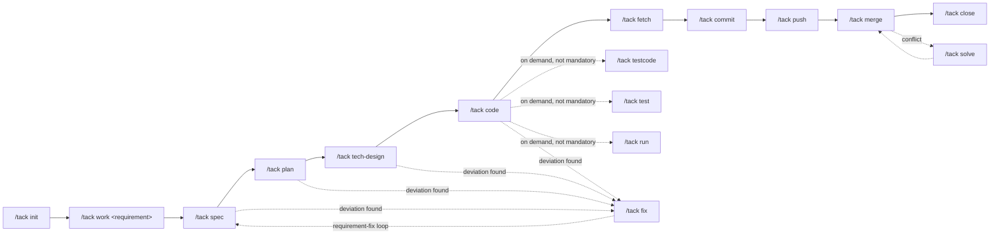

Tack's development workflow (`development`) is the core state machine for software R&D, covering the complete lifecycle from requirement intake to delivery. It orchestrates all major dev commands in sequence, tracks progress in `status.yaml` at every stage, and separates the mandatory delivery chain from on-demand commands — so testing, code review, and release checks never block a commit or merge unless you ask for them.

## Trigger Words

The development workflow activates when Tack detects any of these intents:

- `development workflow`, `development`, `/dev`
- `requirement development`, `feature development`
- Chinese: `开发工作流`, `需求开发`, `功能开发`

## State Transitions

The `status` field in `$work/status.yaml` follows this state machine under the development workflow:

```
initialized → planning → developing → reviewing → merged → completed
                   \          \           \
                    └──────── blocked (any stage, when input/dependency is missing)
```

| State | Meaning | Entry Condition |
|-------|---------|-----------------|
| `initialized` | Workspace created, requirement not yet confirmed | `work` completes |
| `planning` | Requirement analysis in progress (`spec`/`plan`/`tech-design`) | `input.md` contains a real requirement; `spec` begins |
| `developing` | Coding in progress (`code`) | `plan.md` confirmed and `tasks` list generated |
| `reviewing` | Code review and merge in progress | Development complete, committed and pushed, MR/PR raised |
| `merged` | Merged into main branch | Platform or local merge completed |
| `completed` | Workspace wrap-up complete | `close` completes |
| `blocked` | Stalled | Missing requirement, dependency, or awaiting review; reason written to `current.next` |

Any blocked stage can enter `blocked` — the blocking reason is recorded in `status.yaml` and the workflow returns to the original state once unblocked.

## Main Development Chain

The mandatory delivery sequence runs left-to-right. On-demand commands branch off but never sit on the main chain:



## Stages and Commands

| # | Stage | Command | Output | Status / Progress After |
|---|-------|---------|--------|------------------------|
| 1 | Initialize project space | `init` | `AGENTS.md` project info, `repo/` linked | — |
| 2 | Create workspace | `work` | `space/<YYYYMMDD>-<branch>/`, worktrees, `AGENTS.md` work entry, roster | `initialized` |
| 2.5 | Code understanding *(optional)* | `ask` | `$work/wiki/<repo>-analysis.md`, Q&A docs | `progress.ask` |
| 3 | Requirement planning | `spec` | `spec.md` (story split, acceptance criteria, boundaries) | `planning` / `progress.spec` |
| 4 | Development plan | `plan` | `plan.md` (option comparison for complex tasks, task list), `status.yaml` `tasks` | `planning` / `progress.plan` |
| 5 | Technical review | `tech-design` | `tech-design.md` | `planning` / `progress.tech-design` |
| 6 | Coding | `code` | Code in worktree | `developing` / `progress.code` |
| 6.5 | Fix *(any stage)* | `fix` | Updated `spec`/`plan`/`tasks`/code in sync | Returns to corrected stage |
| 7 | On-demand commands | `testcode` `test` `run` `code-review` `release-check` | See table below | `progress.*` fact only |
| 8 | Fetch / commit / push | `fetch` `commit` `push` | Committed branch, remote ref, `mr_url` | `developing` |
| 9 | Code review and merge | `merge` | Review conclusion + MR/PR merged | `reviewing → merged` |
| 10 | Close workspace | `close` | Delivery summary, wiki distilled, guidance crystallized, worktree removed | `completed` |

## On-Demand Commands

These commands are **not mandatory steps** — they occupy no position on the main state chain and never block commit, push, merge, or close. After `code` completes you can go straight to `fetch` → `commit` → `push`. The AI never proactively asks "shall we test?" — trigger these explicitly when you need them. Skipping them requires no "skipped" marker.

| Command | Purpose | Output | Progress Flag |
|---------|---------|--------|---------------|
| `testcode` | Unit-test-driven requirement-code consistency review; checks implementation against spec/plan acceptance criteria; fixes go to code, not tests; 90% coverage is one exit criterion | Test code, review findings, defect fixes | `progress.testcode` |
| `test` | System test plan: turns test descriptions into an actionable `$work/test.md`; scripts land in `run/` when needed | `$work/test.md` | `progress.test` |
| `run` | Execute scripts: initializes `run/` when absent (`run.md` + `local/`); executes per checklist when `run.md` exists; sensitive data goes to `run/local/` (gitignored) | Execution results | `progress.run` |
| `code-review` | Independent pre-merge review: uses `plan`/`tech-design` as spec and the three-dot diff against the target branch as facts; analyzes changes function-by-function for correctness and hazards | `$work/code-review.md` | `progress.review` |
| `release-check` | Go-live checklist: database migration statements, config change templates, new API permission requests, new middleware resource requests | `$work/release-check.md` | `progress.release_check` |

<Note>
The `/tack close` command triggers automatic self-evolution. Guidance, corrections, and supplementary agreements collected during the task as raw entries in the `guidance` list of `status.yaml` are crystallized into `workflow`/`cmd`/`rule` entries, with landing points verified by `check-guidance.sh`. This forms a "collect → crystallize → verify" loop — no manual `/tack record` invocation required.
</Note>

## Context Loading Principles

Tack enforces a strict context-loading discipline across `spec`, `plan`, `code`, and `testcode`:

<CardGroup cols={2}>
  <Card title="Grep First, Load Relevant" icon="magnifying-glass">
    Always locate with `grep` before loading. Never do a full-repo read — only relevant fragments are loaded to conserve tokens.
  </Card>
  <Card title="Code Is the Single Source of Truth" icon="code">
    Wiki provides what code cannot — business context, service maps, and conventions. Volatile call-chain details stay in workspace analysis documents only.
  </Card>
  <Card title="Three-Level Degradation" icon="layer-group">
    When knowledge is insufficient: `$root/wiki/` (cross-workspace consensus) → `$work/wiki/` (workspace-local, check commit freshness) → read the code directly. Never stop at "the wiki doesn't cover this."
  </Card>
  <Card title="No Circular Amplification" icon="ban">
    Wiki entries are sourced only from raw workspace output, code, git history, and user-supplied material. Existing AI-synthesized pages must never be the sole source for updating another page.
  </Card>
</CardGroup>

## status.yaml State Writeback

`work-status.sh` writes back to `$work/status.yaml` deterministically at each stage boundary. The script syntax is:

```bash
sh harness/script/work-status.sh space/20261001-user-login/status.yaml \
  set status planning stage spec next "Generate and confirm spec.md"

sh harness/script/work-status.sh space/20261001-user-login/status.yaml \
  set progress.spec true
```

Key writeback rules:

- **`current.stage`** — updated to the active command name (`spec`, `plan`, `code`, `fix`, …) before each command starts
- **`current.task`** — the task ID and title currently being worked on
- **`current.next`** — the next action (or blocking reason when `status: blocked`)
- **`tasks[].status`** — flows `pending → in_progress → done → blocked`, maintained by `code`, `testcode`, and `fix`
- **`progress.*`** — set to `true` after the corresponding command completes and the user confirms
- **`guidance[]`** — a `raw` entry is appended automatically whenever the user guides, corrects, or adds agreements to the AI's approach; `status` transitions to `distilled` at `close`
